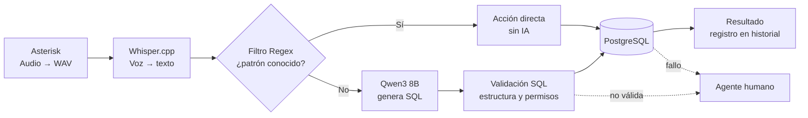

# VoxIBD

**Sistema de atención al cliente por llamadas con Inteligencia Artificial.**

VoxIBD es un callbot que atiende llamadas telefónicas (VoIP), entiende lo que pide el cliente en lenguaje natural y ejecuta de forma automática operaciones sencillas sobre una base de datos, sin intervención de un agente humano. Cuando una petición no se puede resolver sola, se deriva a una persona.

> Proyecto de **Crèdit de síntesi** · Institut Puig Castellar · ASIX2A
> Estado: 🚧 en desarrollo

---

## Índice

- [¿Qué problema resuelve?](#qué-problema-resuelve)
- [Cómo funciona](#cómo-funciona)
- [Funcionalidades](#funcionalidades)
- [Roles de usuario](#roles-de-usuario)
- [Tecnologías](#tecnologías)
- [Requisitos](#requisitos)
- [Instalación](#instalación)
- [Limitaciones conocidas](#limitaciones-conocidas)
- [Hoja de ruta](#hoja-de-ruta)
- [Autores](#autores)

---

## ¿Qué problema resuelve?

Las empresas con mucho volumen de llamadas dedican a sus agentes un gran número de gestiones simples y repetitivas. VoxIBD las automatiza para:

- Reducir los tiempos de espera de los clientes.
- Liberar a los agentes para que se centren en consultas e incidencias que requieren atención especializada.
- Mantener un historial trazable de todas las operaciones realizadas.

## Cómo funciona



1. **Recepción:** Asterisk recibe la llamada y obtiene el audio en formato WAV.
2. **Transcripción:** Whisper.cpp convierte el audio en texto.
3. **Filtro Regex:** si el texto coincide con un patrón conocido, se ejecuta la acción predefinida sin usar IA (más rápido y barato).
4. **Interpretación con IA:** si no hay coincidencia, Qwen3 8B (vía Ollama) identifica la intención y genera la consulta SQL.
5. **Validación:** se comprueba que la consulta tenga una estructura válida y que la operación esté autorizada.
6. **Ejecución y registro:** se ejecuta en PostgreSQL y el resultado (o el error) queda registrado en el historial.
7. **Derivación:** si algo falla, la solicitud pasa a un agente humano.

## Funcionalidades

- Consultas y modificaciones **limitadas** en la base de datos mediante llamada y lenguaje natural.
- Menú por teclado (DTMF), p. ej. «Pulsa 1 para aplicar el idioma inglés».
- Atención en varios idiomas.
- Validación de las consultas SQL antes de ejecutarlas.
- Los usuarios no tienen acceso completo a la base de datos; solo a operaciones autorizadas.
- Web de historial de operaciones (compatible con móvil y ordenador).
- Panel de administración para configurar tono, idioma, flujos, guiones y reglas de escalado.
- Derivación a agentes humanos con el contexto de lo que el cliente intentó hacer.

## Roles de usuario

| Rol | Qué puede hacer |
|---|---|
| **Administrador** | Accede al panel de gestión: parámetros, guiones, perfiles, etc. |
| **Trabajador / Agente** | Revisa las consultas realizadas y atiende las solicitudes no resueltas automáticamente. |
| **Cliente** | Hace solicitudes por llamada y consulta su propio historial en la web. |

## Tecnologías

| Componente | Uso |
|---|---|
| [Asterisk](https://www.asterisk.org/) + [FreePBX](https://www.freepbx.org/) | Centralita VoIP y gestión de llamadas |
| Python | Lógica del bot y opciones del menú |
| Bash | Scripts de envío de transcripciones y automatización |
| [Whisper.cpp](https://github.com/ggml-org/whisper.cpp) | Reconocimiento de voz (voz a texto) |
| [Qwen3 8B](https://ollama.com/library/qwen3) + [Ollama](https://ollama.com/) | Interpretación de peticiones y generación de SQL, en local |
| PostgreSQL | Base de datos |
| InfinityFree | Hosting gratuito de la página web |

## Requisitos

- Servidor/máquina virtual con Asterisk y FreePBX.
- Python 3, Bash y PostgreSQL.
- Ollama con el modelo Qwen3 8B descargado.
- Whisper.cpp compilado y un modelo de transcripción.
- Hardware con recursos suficientes para ejecutar los modelos de IA (ver [limitaciones](#limitaciones-conocidas)).

> Las versiones de Asterisk, FreePBX, Python, PostgreSQL, Ollama y Whisper.cpp deben ser compatibles entre sí.

## Instalación

> 🚧 Sección pendiente de completar a medida que avance el desarrollo.

```bash
# 1. Clonar el repositorio
git clone https://github.com/<usuario>/voxibd.git
cd voxibd

# 2. Preparar el entorno (Asterisk, FreePBX, PostgreSQL, Ollama, Whisper.cpp)
# 3. Crear la base de datos
# 4. Configurar variables y parámetros
# 5. Arrancar los servicios
```

## Limitaciones conocidas

- **Recursos de hardware:** ejecutar IA en local consume mucho; con los equipos actuales el sistema aguanta 1–2 usuarios simultáneos, no ~20.
- **Calidad del audio:** ruido, interferencias o mala pronunciación pueden causar errores de transcripción.
- **Hosting gratuito:** puede limitar recursos, rendimiento y disponibilidad de la web.
- **Dependencia de los modelos de IA:** cambios de modelo o de configuración pueden alterar el rendimiento.

## Hoja de ruta

- [ ] Preparar el entorno de desarrollo
- [ ] Estructura inicial del repositorio y de la base de datos
- [ ] Sistema de llamadas (Asterisk + FreePBX)
- [ ] Transcripción de voz (Whisper.cpp)
- [ ] Procesamiento de peticiones (Regex + Qwen3 8B) y validación SQL
- [ ] Gestión de operaciones en la base de datos
- [ ] Web de historial y panel de administración
- [ ] Pruebas funcionales, de carga y de seguridad
- [ ] Extras: gestión del bot desde la web, selección de idiomas, portabilidad

## Autores

- **Derickson A. Mendez**
- **Eric Martín**

ASIX2A · Institut Puig Castellar
